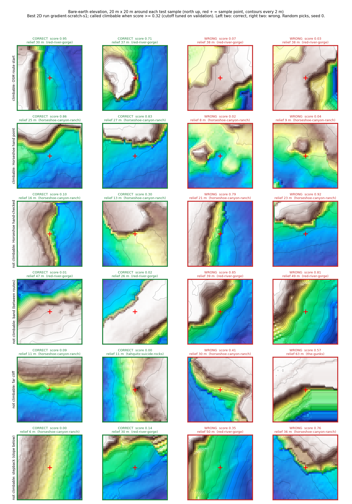
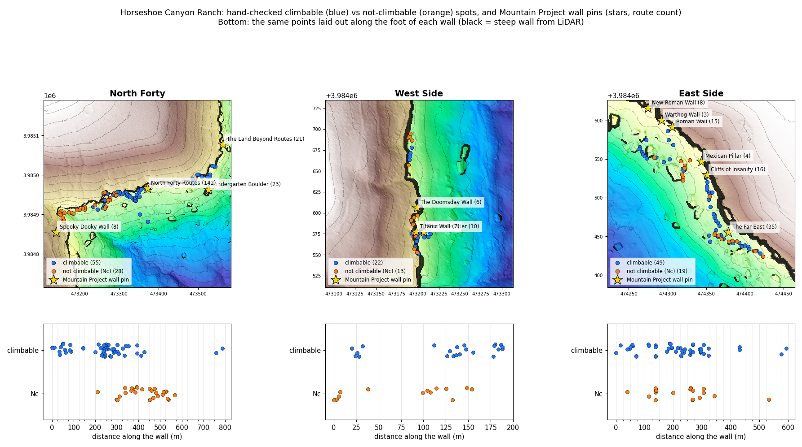

# 2D vs 3D climbability models: progress so far (2026-11-14)

> **These are V3 results.** The 2D models were rerun on the V4 labels: see [`../v4/README.md`](../v4/README.md). On V4 the V3 shortcut is gone and 2D no longer beats 3D. V3 runs are now saved in `runs/model2d/v3/`.

The 2D model beats the 3D model on validation and test, ties on Horseshoe Canyon, and like 3D cannot yet tell good rock from bad rock.

Files in this folder:

| file | contents |
|---|---|
| `comparison.csv` | every 2D run and baseline, next to the 3D V3 runs (from `scripts/model2d_compare.py`) |
| `examples_correct_vs_wrong.png` | elevation of 2 correct and 2 wrong test samples per sample type, best 2D run |
| `hcr_climb_vs_nc_by_wall.png` | Horseshoe hand-checked climbable vs not-climbable spots along each wall, with Mountain Project wall pins |

## What we did

We built a 2D model and compared it with the 3D models on the exact same samples and train / validation / test split (fine-tuning set v3).

- **Input:** a top-down image of each LiDAR block, 20 m x 20 m at 0.5 m pixels, centred on the sample point.
- **Two image types:** *gradient* (how steeply the bare ground rises east and north, 2 layers) and *in-between* (lowest point, highest point, point count, 3 layers).
- **Model:** ResNet, trained three ways: from scratch, linear probe (ImageNet weights, only the last layer trained), and full fine-tune (ImageNet weights, all layers trained).
- **Runs:** 3 seeds per setup.
- **Baselines with no training:** simple rules on the bare-ground height, to check the model learned more than "steep = climbable".
  - **Max slope:** steepest spot within 2.5 m of the centre.
  - **Mean slope:** average steepness within 2.5 m of the centre.
  - **Relief:** highest minus lowest ground in the whole 20 m square.
- **Scoring:** AUROC, the chance a climbable sample scores above a non-climbable one (0.5 = guessing, 1 = perfect). We pick runs on validation and report test and Horseshoe Canyon, a held-out area with hand-checked labels.

## Results: 2D vs 3D

2D wins by 5-12 AUROC points on validation and test; on Horseshoe Canyon the two are about even.

| Model | Val AUROC | Test AUROC | Test, hard negatives | Horseshoe AUROC | Horseshoe hand points only |
| --- | --- | --- | --- | --- | --- |
| Best 3D (PointNet++ decoder_head) | 0.783 | 0.771 | 0.692 | 0.834 | 0.566 |
| All 12 3D runs (range) | 0.72-0.79 | 0.71-0.77 | 0.58-0.70 | 0.76-0.83 | 0.46-0.59 |
| 2D gradient, scratch (3-seed mean) | 0.904 | 0.832 | 0.721 | 0.798 | 0.563 |
| 2D gradient, full fine-tune (3-seed mean) | 0.897 | 0.835 | 0.712 | 0.814 | 0.570 |
| 2D in-between, full fine-tune | 0.833 | 0.776 | 0.695 | 0.796 | 0.618 |
| Baseline: max slope (no training) | 0.816 | 0.783 | 0.601 | 0.747 | 0.478 |
| Baseline: relief (no training) | 0.829 | 0.672 | 0.568 | 0.669 | 0.604 |

- **Hard negatives** = band and Horseshoe hand-checked samples (see below).
- **Horseshoe hand points only** = climbable vs hand-checked not-climbable spots, all on real walls. This is the question we care about, and every model is near 0.5-0.6.
- **The max-slope rule beats every 3D run on test.** Much of what 3D learned is "steep = climbable". Trained 2D clearly beats the baselines on hard negatives (0.72 vs 0.60).
- Gradient images beat in-between images. Scratch ties ImageNet fine-tune. Seed-to-seed spread is at most 0.02.
- 3D numbers are one seed each, so their uncertainty is larger than it looks.

## What 3D has that 2D does not yet

- **Pretraining on LiDAR pseudolabels.** Before fine-tuning, the 3D models learn to label every point as ground, vegetation, steep terrain, or cliff across many areas (cliff IoU on test areas: 0.56-0.57). No 2D run has this step yet; the 2D pseudolabel run folder is empty.
- **More fine-tuning setups:** decoder_head, gradual_unfreeze, and S3DIS (indoor scenes) initialisation.
- **Gap on our side:** the 3D per-sample scores are not in the repo, so the 3D accuracy by sample type below is only partly filled in.

## Accuracy by sample type

The easier the negative, the better the model does; on the verified hand-checked negatives it is a coin flip.

Best 2D run (gradient, scratch, seed 1), test set. For climbable types, accuracy = share called climbable; for not-climbable types, share called not climbable. "Val cutoff" = score threshold tuned on validation (0.315 for 2D, 0.25 for 3D).

| Type | Label | What it is | Test samples | 2D, val cutoff | 3D, val cutoff |
| --- | --- | --- | --- | --- | --- |
| osm | climbable | Route start mapped in OpenStreetMap (mostly Red River Gorge) | 180 | 0.82 | not saved |
| handgathered | climbable | Horseshoe spot checked on site | 119 | 0.64 | 0.58 |
| handgathered_nc | not climbable | Horseshoe rock wall judged not climbable on site; the only verified negatives | 58 | 0.47 | 0.55 |
| band | not climbable | Cliff 10-40 m from any known route at a well-mapped crag | 216 | 0.66 | not saved |
| far_cliff | not climbable | Cliff far from any known route | 51 | 0.82 | not saved |
| stepback | not climbable | Slope or flat ground 12-20 m out from a route; not a wall | 603 | 0.87 | not saved |

- **Band labels are unreliable.** They assume the cliff between mapped routes is bad rock. At Horseshoe this was right 39-93% of the time depending on how many routes are mapped, often no better than random wall spots.
- **Hand-checked negatives sit next to real routes.** 35 of 58 have a climbable spot inside their own 20 m square, so the image partly shows climbable rock.
- 18 test samples (14 osm, 4 handgathered) have no LiDAR points at the centre and are left out.

## Accuracy vs where the point sits in height

The model mostly asks "is this point at the bottom of a drop?": low points are called climbable and high points not climbable, whatever the true label.

For each sample: position = (height at the centre point - lowest height in the square) / (highest - lowest). **High ground** = above 2/3, **low ground** = below 1/3. Same 2D run and cutoff (0.315) as above.

| Type | Label | Share on high ground | Accuracy on high ground | Accuracy on low ground |
| --- | --- | --- | --- | --- |
| osm | climbable | 21% | **0.46** | 0.97 |
| handgathered | climbable | 15% | **0.06** | 0.91 |
| band | not climbable | 29% | 0.95 | **0.13** |
| handgathered_nc | not climbable | 12% | 1.00 | **0.24** |
| stepback | not climbable | 30% | 0.98 | 0.59 |

- **Some climbable points are on top of the cliff.** About 1 in 5 OSM starts sit high in their square. Some are real ledge starts (Red River Gorge has stepped cliffs); some are likely location errors.
- **Negatives the model gets right are mostly ones that happen to sit high.** Hand-checked negatives at a wall base, the ones that matter, are mostly missed (0.24).
- far_cliff is left out: too few samples on high (6) or low (4) ground.

## Takeaways and next steps

Both models are good wall finders, not yet climbable-rock finders; the main limit is label quality, not model type.

- [ ] Run 2D with pseudolabel pretraining, to match 3D.
- [ ] Get the 3D per-sample scores to fill the 3D column above.
- [ ] Check OSM starts that sit on top of the cliff: ledge start or wrong location.
- [ ] Try a smaller unit than the 20 m square (rock quality changes within a few metres), or score only the centre spot.
- [ ] Find more reliable non-climbable examples; today the only verified ones are 58 points at Horseshoe, all in the test set.

Labelling whole walls instead of routes does not help: at Horseshoe, 72% of hand-checked negatives share a 50 m stretch with a climbable spot, and Mountain Project's walls are larger still.

## Other notes

- **Position layer:** we also tried an extra input layer giving each pixel's distance from the image centre, so the model knows where a feature sits. It brought no meaningful gain (all scores within 0.04, most within 0.02), so default training is without it.
- The 2D numbers in this doc come from the runs with the position layer; the no-position runs score about the same.
