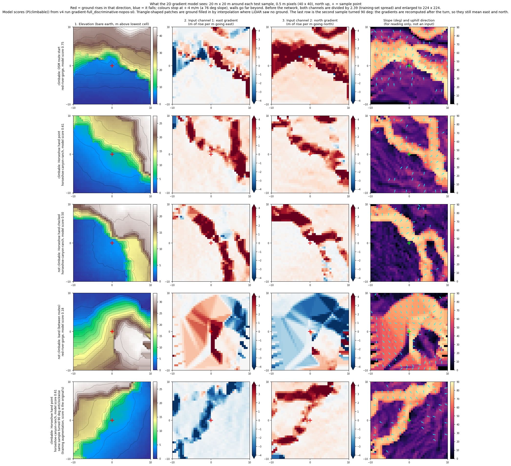
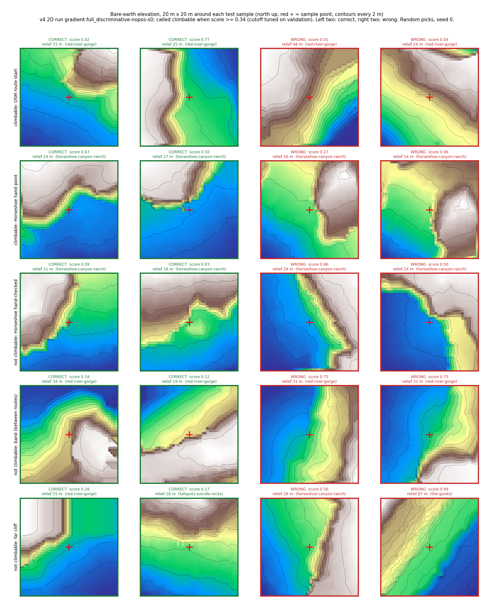
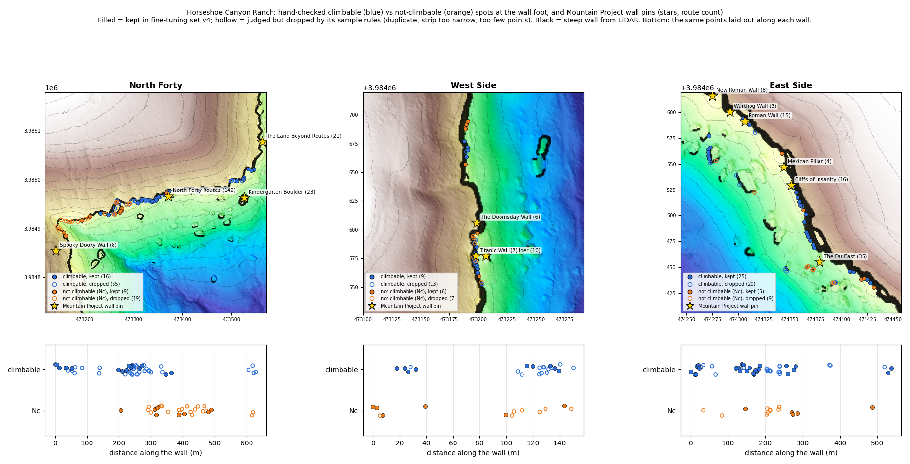

# 2D vs 3D climbability models on V4 labels (2026-11-17)

On V4, 2D and 3D are about even on validation and Red River Gorge. On Horseshoe Canyon, 3D's best run is ahead, and neither beats plain wall geometry.

V4 is the teammate's relabelled fine-tuning set (`data/finetune/v4`, see `docs/results/v4/README.md`). V3 results are in [`../v3/README.md`](../v3/README.md). **V3 and V4 numbers are not comparable**: V4 has different samples and labels, and it removes the V3 shortcut that inflated V3 scores.

Files in this folder:

| file | contents |
|---|---|
| `comparison.csv` | every 2D V4 run and baseline, next to the 3D V4 runs (from `scripts/model2d_compare.py --data v4`) |
| `model_inputs_gradient.png` | what the gradient model sees: elevation and the two gradient input channels for one test sample per type (from `scripts/model2d_figures.py`) |
| `examples_correct_vs_wrong.png` | elevation of 2 correct and 2 wrong test samples per sample type, one 2D run (from `scripts/model2d_figures.py`) |
| `hcr_climb_vs_nc_by_wall.png` | Horseshoe hand points along each wall, kept vs dropped by V4, with Mountain Project wall pins (from `scripts/model2d_figures.py`) |
| `samples_preview.png` | slope images of 8 random V4 samples per sample type (from `scripts/model2d_rasterize.py --name v4`) |

## How to read the numbers

This document uses two different metrics. Every table and column says which one it shows.

| Metric | What it measures | Needs a cutoff? | Used in |
| --- | --- | --- | --- |
| **AUROC** | Ranking: the chance a randomly picked climbable sample gets a higher score than a randomly picked not-climbable one. 0.5 = guessing, 1 = perfect. | No | Results: 2D vs 3D; Where the point sits in height |
| **Accuracy (per type)** | Share of one sample type the model calls correctly at its cutoff. For a climbable type: share scored at or above the cutoff. For a not-climbable type: share scored below it. 1 = all correct. | Yes: the validation cutoff | Accuracy by sample type |

- **Score:** every model gives each sample a score. For the trained 2D models, it is P(climbable), a sigmoid output between 0 and 1. For the no-training baselines, it is the raw quantity (slope / 90, or relief in metres).
- **Cutoff:** a sample is called climbable when its score is at or above the cutoff. Each run picks its own cutoff on the validation set: the one with the highest balanced accuracy there. Test and Horseshoe are never used to pick it.
- **3-seed mean +- spread:** each 2D setup is trained 3 times with different random seeds. Tables show the mean over the 3 runs. "+-" is the standard deviation across them; "lowest-highest seed" is the range.
- **95% range:** for one run on one set, the range the AUROC falls in when the samples are resampled 1,000 times (bootstrap). It shows how much the number could move with a different draw of samples.

## What changed from V3

- **Samples:** 2,522 instead of 6,254. V4 drops the `stepback` type (flat ground 12-20 m out from a route), so every remaining sample is at a wall.
  - Training: 927 osm, 673 band, 129 far_cliff.
  - Validation: 391 samples.
  - Test: 402 samples. These are 276 from Red River Gorge, 74 from Horseshoe (the 70 hand points plus 4 far_cliff), and 52 from 8 other areas.
- **One labelling rule:** every sample point is moved to the foot of its wall. Almost no sample now sits high in its 20 m square (0-5% per type, against 12-30% in V3). This removes the "bottom of the drop = climbable" shortcut V3's 2D model leaned on.
- **Judged Horseshoe points:** judges reviewed each hand point and gave a confidence (high / medium / low). "High + medium" below leaves out the 12 low-confidence points.
- **Same 2D setup as V3:** 20 m images at 0.5 m pixels, ResNet-18, 3 strategies x 2 image types x 3 seeds, no position layer. Only the dataset changed.

## What the 2D model sees: elevation gradients

The best 2D setups use the *gradient* input (from Rafique et al. 2022). For each sample:

1. **Elevation.** Take the bare-earth height of a 20 m x 20 m square around the sample point, on a 40 x 40 grid of 0.5 m pixels, north up. Heights are in metres above the lowest pixel.
2. **Gradient.** For every pixel, compute how fast the ground rises going east and going north, in metres of height per metre walked. These two numbers per pixel are the two input channels, like a 2-colour image. Flat ground is 0, a 45 deg slope is 1, and a vertical wall is very large.
3. **Scale.** Divide both channels by 2.39, the typical size of a gradient in the training set. This puts the numbers in the range the network trains well on.
4. **Resize.** Enlarge the 40 x 40 image to 224 x 224, the size ResNet-18 was built for, and pass it to the network. Its first layer was made for 3 colour channels; it is adapted to take 2.

Why gradients and not the raw height: the same wall should look the same whether its base is at 300 m or 1,500 m. Gradients only describe the shape of the ground.

**Training augmentation:** each training image is randomly turned by a multiple of 90 deg and/or mirrored. The gradients are computed *after* the turn, so channel 1 always means "rise going east" and channel 2 "rise going north". The model therefore cannot rely on a wall facing a particular direction.

How to read the figure:

- **Column 1** is the elevation: blue = low, white = high, contour lines every 2 m. The + is the sample point.
- **Columns 2 and 3** are the two channels the network actually receives: red = the ground rises in that direction, blue = it falls, white = flat. The colours stop at +-4 m/m (a 76 deg slope); real walls go far beyond, so walls show as solid dark bands.
- **Column 4** is for reading only, not an input: the slope in degrees, with arrows pointing uphill on ground steeper than 30 deg.
- **Last row:** the second sample again, turned 90 deg as in training. The wall that showed in the north channel now shows in the east channel, with its sign flipped.
- **Triangle-shaped patches** (row 4) are ground filled in by interpolation, where the LiDAR saw no ground under trees or overhangs.
- The model scores in the row labels are P(climbable) from one run (gradient full fine-tune, seed 0).

In all four examples the strongest signal is the band of steep wall next to the point. A climbable and a not-climbable wall of similar height and shape (rows 2 and 3) give very similar inputs, and the model scores them close together (0.61 and 0.50). That is the limit the results below show.



## Where the test samples come from

Test is not Red River Gorge alone: every area gives about 15% of its samples to test. Red River Gorge just dominates because it is 81% of the whole dataset.

The split works in two steps (`assign_splits` in `crag/finetune_data.py`):

1. **Horseshoe is held out whole.** All 74 Horseshoe samples go to test, so the model never trains on that area.
2. **Every other area is split about 70 / 15 / 15** into train / validation / test. Samples within a set distance of each other form a group (roughly one crag), and whole groups go to one split. That way a test sample never has a near-copy next to it in training.

| Area | Train | Validation | Test | Total |
| --- | --- | --- | --- | --- |
| Red River Gorge | 1,450 | 329 | 276 | 2,055 |
| Horseshoe Canyon Ranch | 0 | 0 | 74 | 74 |
| Leavenworth | 108 | 23 | 23 | 154 |
| The Gunks | 39 | 9 | 10 | 58 |
| 7 other areas | 132 | 30 | 19 | 181 |
| **All** | 1,729 | 391 | 402 | 2,522 |

Red River Gorge dominates because of where the labels come from:

- **Climbable:** most climbable samples are OpenStreetMap route starts. Red River Gorge has 1,044 of the 1,201 mapped in V4.
- **Not climbable:** the `band` negatives (wall between known routes) are only made at well-mapped crags. 989 of the 1,049 are at Red River Gorge.
- **Other areas:** they have few mapped routes, so most of their samples are `far_cliff` negatives. Saint George, Zion and Tahquitz have almost no climbable samples at all.

So the all-areas test AUROC mostly measures Red River Gorge. The teammate's V4 3D table reports Red River Gorge separately. Horseshoe is the only truly unseen area, and it has only 70 hand points.

## Results: 2D vs 3D (AUROC)

**Every number in the main table below is AUROC** (no cutoff involved). 2D rows are 3-seed means; "+-" is the standard deviation across the 3 seeds. 3D rows are single runs from `docs/results/v4/finetune_comparison.csv`. V4's 3D table has no all-areas test AUROC, so that column is empty for 3D.

Every model trains on the same training set and is scored on exactly the same samples (no sample is dropped for missing LiDAR):

| Set | Samples | Climbable | Not climbable |
| --- | --- | --- | --- |
| Training | 1,729 | 927 | 802 |
| Validation | 391 | 133 | 258 |
| Test, all areas | 402 | 191 | 211 |
| Test, Red River Gorge only | 276 | 121 | 155 |
| Horseshoe hand points | 70 | 50 | 20 |
| Horseshoe high + medium judge confidence | 58 | 40 | 18 |

Training samples come from every area except Horseshoe. Each 2D epoch draws 4,000 of them with replacement, half climbable and half not (weighted by label confidence), so the training set's 927 / 802 mix does not set the class balance the model sees.

| Model | Validation AUROC (391) | Test AUROC, all areas (402) | Red River Gorge test AUROC (276) | Horseshoe hand points AUROC (70) | Horseshoe high + medium AUROC (58) |
| --- | --- | --- | --- | --- | --- |
| Best 3D (PointNet++ scratch) | 0.752 | | 0.724 | **0.754** | **0.761** |
| All 8 3D runs (range) | 0.68-0.75 | | 0.67-0.72 | 0.60-0.75 | 0.63-0.77 |
| 3D baseline: wall geometry (teammate's) | **0.760** | | **0.764** | 0.690 | |
| 2D gradient, full fine-tune | 0.754 +- 0.014 | 0.717 | 0.718 | 0.653 +- 0.066 | 0.660 |
| 2D gradient, scratch | 0.744 +- 0.006 | **0.738** | 0.739 | 0.618 +- 0.016 | 0.647 |
| 2D gradient, linear probe | 0.722 +- 0.006 | 0.703 | 0.702 | 0.645 +- 0.032 | 0.651 |
| 2D in-between, scratch | 0.725 +- 0.022 | 0.690 | 0.706 | 0.679 +- 0.030 | 0.693 |
| 2D in-between, full fine-tune | 0.730 +- 0.029 | 0.674 | 0.671 | 0.591 +- 0.044 | 0.604 |
| 2D in-between, linear probe | 0.642 +- 0.020 | 0.619 | 0.591 | 0.657 +- 0.040 | 0.657 |
| Baseline: max slope (no training) | 0.665 | 0.654 | 0.643 | 0.566 | 0.594 |
| Baseline: relief (no training) | 0.631 | 0.583 | 0.609 | 0.545 | 0.590 |
| Baseline: mean slope (no training) | 0.403 | 0.416 | 0.455 | 0.388 | 0.425 |

- **Validation and Red River Gorge: a tie.** The best 2D setups (validation AUROC 0.74-0.75) match the best 3D runs (0.75), and 2D gradient scratch (Red River Gorge AUROC 0.739) is a little above 3D's best (0.724). The V3 gap of 5-12 AUROC points in 2D's favour is gone. V4 removed the shortcut 2D was using.
- **Horseshoe: 3D's best run is ahead, but the gap is uncertain.** The 2D setup that does best on Horseshoe (in-between, scratch) averages a Horseshoe hand-point AUROC of 0.679, against 0.754 for the best 3D run. With only 70 points, the 95% range on one run is about +-0.15 (gradient full fine-tune, seed 0: AUROC 0.58, 95% range 0.42-0.73). 3D also varies a lot between runs (0.60-0.75), so the 3D best is partly luck of the draw.
- **Neither beats wall geometry on validation or Red River Gorge.** The teammate's wall-geometry baseline (AUROC 0.76) is at or above every 2D and 3D run there.
- **Steepness alone no longer works.** In V3, max slope alone had a validation AUROC of 0.82. In V4 it has 0.67, and mean slope is below guessing (0.40). Most V4 negatives are steep walls too, so "steeper = climbable" fails. The trained 2D models clearly beat these baselines (validation AUROC 0.72-0.75 vs 0.67).
- **Gradient images still beat in-between images** on validation and Red River Gorge. On Horseshoe, in-between scratch is the best 2D setup, but within the uncertainty.
- **Picking the best seed on validation does not pick the best Horseshoe run.** The top-validation 2D run (gradient full fine-tune, seed 0: validation AUROC 0.764) has the lowest Horseshoe hand-point AUROC of its setup (0.58, against 0.70 and 0.68 for seeds 1 and 2). This is why every table in this document reports 3-seed means or all three seeds, never one run alone.

## Accuracy by sample type (accuracy at the validation cutoff)

**Every number in this table is accuracy, not AUROC.** AUROC needs both labels, and each type here has only one, so accuracy is the only measure per type.

Best 2D setup on validation (gradient, full fine-tune), test set, all 3 seeds. Each seed uses its own validation cutoff (0.337, 0.459, 0.495). For climbable types, accuracy = share called climbable; for not-climbable types, share called not climbable.

| Type | Label | What it is | Test samples | Accuracy, seed 0 | Accuracy, seed 1 | Accuracy, seed 2 | Accuracy, mean |
| --- | --- | --- | --- | --- | --- | --- | --- |
| osm | climbable | Route start mapped in OpenStreetMap, moved to the wall foot | 141 | 0.71 | 0.58 | 0.70 | 0.66 |
| handgathered | climbable | Horseshoe spot checked on site, reviewed by judges | 50 | 0.66 | 0.36 | 0.74 | 0.59 |
| handgathered_nc | not climbable | Horseshoe wall judged not climbable on site | 20 | 0.40 | 0.80 | 0.45 | 0.55 |
| band | not climbable | Wall 10-40 m from any known route at a well-mapped crag | 144 | 0.62 | 0.65 | 0.67 | 0.65 |
| far_cliff | not climbable | Wall far from any known route | 47 | 0.68 | 0.79 | 0.74 | 0.74 |

- **The Horseshoe hand points swing the most between seeds.** Climbable ones are found 36-74% of the time, not-climbable ones rejected 40-80%. Seed 1 calls far more Horseshoe points "not climbable" than the other two: it rejects 80% of the not-climbable ones but finds only 36% of the climbable ones. A cutoff chosen on validation, which has no Horseshoe points, does not carry over well to Horseshoe.
- **On average the verified negatives are still the hardest** (accuracy 0.55, close to guessing), together with the climbable hand points (accuracy 0.59).
- **Judge confidence:** split by the judges' confidence, the groups are 2-32 points, and the accuracies change by up to 0.6 between seeds. They are too small to read.
- Outside Horseshoe, every type's accuracy sits between 0.58 and 0.79. Unlike V3, there is no easy type the model gets right for free.

The figure below shows examples from **one run only** (gradient full fine-tune, seed 0, cutoff 0.34): for each type, 2 test samples it scored correctly (left, green) and 2 it scored wrongly (right, red), picked at random. The score in each title is that run's P(climbable). Colours show height (blue = low, white = high); the red + is the sample point.

- **These are 2 random picks per cell.** They illustrate the numbers above; they do not prove a pattern on their own.
- **No stepback row:** V4 dropped flat-ground samples, so every type is a spot at or near a wall, unlike the V3 figure.
- **At Horseshoe, wall height decides the call, not the label.** The two wrongly rejected climbable points sit beside short outcrops (relief 14-16 m, against 24-27 m for the two correct ones). The two wrongly accepted not-climbable points sit at the foot of taller, continuous walls (relief 24-29 m, against 18-21 m for the two correct ones). This matches the height section below.



## Where the point sits in height still matters (AUROC)

V4 moved every point to the wall foot, but the model still mostly measures how much wall rises above the point.

Position = (height at the centre - lowest height in the square) / (highest - lowest). A score of 1 - position needs no training and is high when there is a lot of wall above the centre:

**Both columns are AUROC**, the same metric as the main results table. 1 - position is used directly as a score, with no cutoff. The trained column is the best 2D setup on validation (gradient, full fine-tune), as in the main results table: the 3-seed mean, with the lowest and highest seed in brackets.

| Set | AUROC of 1 - position (no training) | AUROC of best 2D setup, 3-seed mean (lowest-highest seed) |
| --- | --- | --- |
| Validation | 0.701 | 0.754 (0.738-0.764) |
| Red River Gorge test | 0.717 | 0.718 (0.698-0.741) |
| Horseshoe hand points | 0.658 | 0.653 (0.578-0.704) |

- On Red River Gorge and Horseshoe, this one number ties the trained model. Only on validation, where checkpoints and cutoffs are chosen, is the model ahead (by 0.05 AUROC).
- This agrees with the teammate's V4 finding that the networks "see little beyond wall height and steepness yet."
- This check is a one-off calculation for this write-up, not a script. It uses the mean of the 4 centre pixels of the bare-earth layer.

## Horseshoe hand points: kept and dropped

V4 keeps 70 of the 173 judged Horseshoe hand points (50 climbable, 20 not climbable). The rest are dropped by V4's sample rules:

| Rule | What it removes | Climbable | Not climbable |
| --- | --- | --- | --- |
| Duplicate | a same-label point within 2 m along the wall (one of the two is kept) | 30 | 8 |
| Strip too narrow | a point of the opposite label within 5 m along the wall, leaving under 1 m of wall on one side | 17 | 15 |
| Too few LiDAR points | fewer than 12 labelled points in the sample's wall strip | 21 | 12 |
| **Dropped** | | **68** | **35** |
| **Kept** | | **50** | **20** |

13 more waypoints (8 climbable, 5 not climbable) were removed earlier, when the judges found no wall near them; they are not on the map.

In the figure, filled dots are kept and hollow dots are dropped. Black = steep wall from LiDAR. Stars are Mountain Project wall pins with their route count. The bottom row lays the same points out along each wall.

- **Climbable and not-climbable spots share the same walls.** On North Forty, most not-climbable spots sit in one stretch (about 200-500 m along the wall) between climbable ones. On West Side and East Side they are mixed in among the climbable spots.
- **The dense, mixed stretches lose the most points.** That is where same-label points are within 2 m (duplicates) and opposite labels are within 5 m (narrow strips). These are also the cases that test whether a model can tell good rock from bad on one wall.
- **Mountain Project pins mark whole walls,** not spots: "North Forty Routes" is one pin for 142 routes along about 600 m of wall. They cannot label individual points.



## Takeaways and next steps

On V4, 2D gives no advantage over 3D, and neither model has learned more than wall height and steepness.

- [ ] Add 1 - position (wall height above the point) to `scripts/model2d_baseline.py` as a standing baseline.
- [ ] Run the Horseshoe folds (`v4-hcr-a` / `v4-hcr-b`, each trains on part of Horseshoe) for 2D, to match the teammate's 3D fold runs.
- [ ] Run 2D with pseudolabel pretraining. The teammate found it does not help 3D on V4, so this is lower priority than in V3.
- [ ] Get more verified not-climbable points: there are still only 20 in V4 (high + medium: 18), all in the test set.
- The close-pair score (`pair_acc` in `comparison.csv`: the share of close climbable / not-climbable pairs where the climbable one scores higher) uses only 4 pairs on V4. Ignore it until there are more.

## How to reproduce

All commands use the GPU venv (`deep-learning-pytorch/.venv`), which needs `pyproj` and `shapely` for rasterizing.

```bash
python scripts/model2d_rasterize.py --name v4        # data/finetune/v4 -> data/raster/v4 (about 5 min)
python scripts/model2d_baseline.py --data v4         # -> runs/model2d/v4/baselines/
python scripts/model2d_sweep.py --data v4            # 18 runs -> runs/model2d/v4/no_pseudolabel/
python scripts/model2d_compare.py --data v4          # -> runs/model2d/v4/comparison.csv
python scripts/model2d_figures.py --data v4          # -> the three figures in docs/results/model2d/v4/
```

Runs are saved by dataset version: `runs/model2d/v3/` and `runs/model2d/v4/`.
